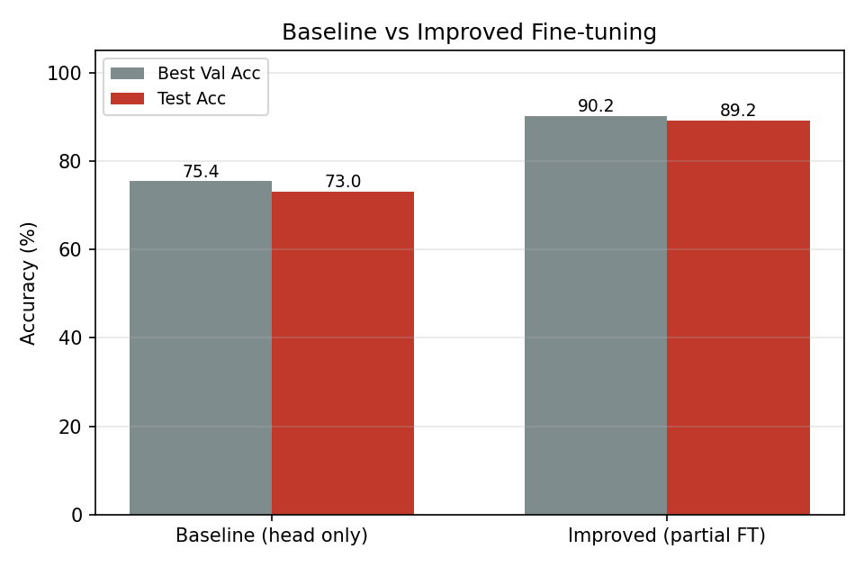

# Thyroid Nodule Benign/Malignant Classification

基于 **TN5000 甲状腺超声数据集** 的结节良恶性二分类，使用改进的 ResNet50（ASPP 多尺度特征 + CBAM 注意力）进行迁移学习。

**最终结果：测试集准确率 89.20%，AUC 0.9404，恶性类召回率 92.07%**（1,000 张独立测试集）。

## Results

| Setting | Best Val Acc | Test Acc | 说明 |
|---|---|---|---|
| Baseline（冻结骨干，只训分类头） | 75.40% | **73.00%** | 塌缩到多数类，全部预测为恶性 |
| **Improved（分层微调 + 类别加权损失）** | 90.20% | **89.20%** | +16.2 pp |

<div align="center">



</div>

测试集（1,000 张）上的详细指标：

| Class | Precision | Recall | F1 |
|---|---|---|---|
| Benign (269) | 0.7906 | 0.8141 | 0.8022 |
| Malignant (731) | 0.9308 | 0.9207 | 0.9257 |

- **AUC = 0.9404**（恶性类，ROC 曲线见 `assets/roc_curve.png`）
- 混淆矩阵：`assets/confusion_matrix.png`
- 训练曲线：`assets/training_curves.png`
- 训练日志与完整指标：`results/`

## Key Findings（本项目最有价值的部分）

第一次实验按"冻结全部骨干、只训练最后一层"的经典做法训练，模型**塌缩到了多数类**——混淆矩阵显示所有样本都被预测为恶性，73% 的"准确率"只是多数类占比（测试集恶性 731/1000），对良性类召回率为 0。

定位到原因（类别不平衡 良：恶 ≈ 3:7 + 可训练参数过少）后做了两处修改：

1. **分层微调**：解冻深层 `layer3/layer4`，与分类头一起训练（浅层仍冻结，避免过拟合）；
2. **逆频率类别加权损失**：按训练集各类样本占比的反比设置 CrossEntropyLoss 权重。

改进后测试集准确率从 73.0% 提升到 **89.2%（+16.2 pp）**，恶性召回 92.07%。两组实验的结果文件分别保存在 `results/results_head.json` 与 `results/results_ft.json`，可复现对照。

## Model Architecture

```
Input (3×224×224)
  └─ ResNet50 backbone (ImageNet pretrained, conv1~layer2 frozen)
      └─ layer4 → (2048×7×7)
          └─ ASPP   : 1×1 + dilation 6/12/18 + global-pool, 5 分支拼接融合  ← 改进点 1
              └─ CBAM : 通道注意力 + 空间注意力                          ← 改进点 2
                  └─ GAP → FC → 2 classes
```

另提供一个图像 + 临床数据特征级拼接的多模态结构 `MultimodalThyroidModel`（见 `model.py`），供后续扩展参考——TN5000 公开标注中不含可用的临床字段，本仓库结果均来自单模态图像分支。

## Dataset

[TN5000](https://github.com/sjxruan/TN5000)（Peng et al., 2023）：5,000 张甲状腺结节超声图像，本仓库使用其官方划分：

| Split | #Images |
|---|---|
| train | 3,500 |
| val | 500 |
| test | 1,000 |

标签取自 VOC 格式 XML 标注中的 `<object><name>` 字段（`0` = 良性，`1` = 恶性）。

下载后按如下目录放置：

```
data/TN5000_forReview/
├── JPEGImages/          # 5000 张 .jpg
├── Annotations/         # 5000 个 .xml
└── ImageSets/Main/      # train.txt / val.txt / test.txt
```

## Quick Start

```bash
pip install -r requirements.txt

# 复现改进版训练（单卡 RTX 4060 约 14 分钟）
python train.py --data-root ./data/TN5000_forReview --finetune-mode partial

# 复现基线（观察塌缩现象）
python train.py --data-root ./data/TN5000_forReview --finetune-mode head

# 用训练好的权重评估并生成混淆矩阵 / ROC 曲线
python evaluate.py --data-root ./data/TN5000_forReview \
                   --weights ./results/best_model_ft.pth --out-dir ./assets

# 从结果 JSON 生成训练曲线与对比柱状图
python plot_results.py --results-dir ./results --out-dir ./assets
```

## Project Structure

```
├── dataset.py         # TN5000 Dataset（按 ImageSets 划分，XML 解析标签）
├── model.py           # Bottleneck / ASPP / CBAM / ResNet50_ASPP_CBAM / 多模态结构
├── train.py           # 训练入口（head / partial 两种微调策略，argparse 可配置）
├── evaluate.py        # 加载权重在测试集评估，输出混淆矩阵与 ROC
├── plot_results.py    # 从结果 JSON 生成训练曲线与对比图
├── results/           # 两组实验的完整指标 JSON 与训练日志
└── assets/            # 结果图表
```

## References

- He et al. *Deep Residual Learning for Image Recognition*. CVPR 2016.
- Chen et al. *Encoder-Decoder with Atrous Separable Convolution (DeepLab v3+)*. ECCV 2018.（ASPP）
- Woo et al. *CBAM: Convolutional Block Attention Module*. ECCV 2018.
- Gong et al. *TN5000: A 5000-image Dataset for Thyroid Nodule Segmentation*. 2023.

## Author

黄馨（Shanxi Normal University, Computer Science, Class of 2027）
